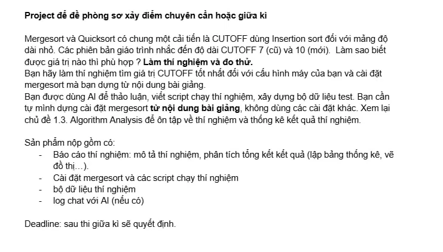

# [Thí nghiệm tìm giá trị CUTOFF tối ưu cho Mergesort]



Merge Sort là thuật toán chia để trị : chia mảng thành các mảng con nhỏ hơn và sau đó sử dụng đệ quy xuống còn 1 phần tử: 
Vấn đề mà MergeSort gặp phải => Việc sử dụng đệ quy ở các mảng nhỏ rất là lãng phí. 
Bàn về độ phức tạp: Về lý thuyết, Insertion Sort sao lại nhanh hơn mảng nhỏ: 
- Merge Sort và Quick Sort sẽ sử dụng độ phức tạp O (n log n) và Insertion Sort sử dụng độ phức tạp là O (n^2). 
- Các con số CUTOFF => đây đều khong phải con số toán học chính xác mà là giá trị thực nghiệm => Đơn giản là người ta thử nhiều giá trị rồi chọn gía trị cho kết quả nhanh nhất mà thôi. 
- Các con số Cutoff như 7 và 10 chỉ đại diện cho thế hệ trước và thế hệ sau này khi có máy tính hiện đại hơn (có cache lớn hơn + dự đonas rẽ nhánh và các vòng lặp đơn giản như Insertion Sort chạy hiệu quả hơn)
Mergesort top-down có một cải tiến quen thuộc: khi đoạn con có độ dài không quá `CUTOFF`, chuyển sang insertion sort thay vì tiếp tục đệ quy. Giáo trình nhắc đến hai giá trị CUTOFF là 7 (cũ) và 10 (mới). Thí nghiệm này đo thời gian chạy với 26 giá trị CUTOFF khác nhau để tìm giá trị phù hợp nhất trên một cấu hình máy cụ thể.

Báo cáo đầy đủ: [`Report.md`](Report.md).

## Cấu trúc thư mục

```
.
├── MergeSortCutOff.java   Cài đặt mergesort + insertion sort (tự code)
├── Data.java              Sinh bộ dữ liệu thí nghiệm
├── Benchmark.java         Đo thời gian và thống kê
├── plot_results.py        Vẽ đồ thị từ kết quả đo
├── data/                  20 file dữ liệu (5 kiểu × 4 kích thước)
├── results/               Kết quả đo (CSV), cấu hình máy và đồ thị
└── Report.md             Báo cáo thí nghiệm
```

## Cách chạy lại thí nghiệm

```bash
# 1. Biên dịch
javac *.java

# 2. Sinh dữ liệu vào data/ (seed cố định nên luôn ra cùng một bộ dữ liệu)
java DataGen

# 3. Đo thời gian: 25 lần đo, 5 vòng warm-up (khoảng 10–30 phút tuỳ vào cấu hình máy)
java -Xms2g -Xmx2g Benchmark

#    Bản chạy thử nhanh: 3 lần đo, 2 vòng warm-up
java Benchmark 3 2

# 4. Vẽ đồ thị vào results/
pip3 install matplotlib
python3 plot.py
```

Tham số đầy đủ của `Benchmark`: `[soLanDo] [soVongWarmup] [thuMucData] [thuMucKetQua]`, mặc định `25 5 data results`.

Khi đo chính thức nên cắm sạc, đóng các ứng dụng khác và không dùng máy trong lúc chạy.

## Thiết kế thí nghiệm

| Biến | Giá trị |
|---|---|
| CUTOFF | 1–20, 24, 28, 32, 40, 48, 64 (CUTOFF = 1 tương đương mergesort thuần, dùng làm mốc so sánh) |
| Kích thước N | 1.000; 10.000; 100.000; 1.000.000 |
| Kiểu dữ liệu | `random`, `sorted`, `reversed`, `nearly_sorted` (đổi chỗ ngẫu nhiên 1% phần tử), `few_unique` (chỉ 10 giá trị khác nhau) |
| Số lần đo | 25 lần cho mỗi tổ hợp, sau 5 vòng warm-up |
| Seed dữ liệu | `20261116` |

Các biện pháp để kết quả đo đáng tin:

- **Cùng dữ liệu cho mọi CUTOFF**: mỗi lần đo copy mảng gốc sang mảng làm việc; thời gian copy không được tính.
- **Warm-up**: chạy bỏ 5 vòng đầu để JIT của Java biên dịch xong mã trước khi đo.
- **Xáo thứ tự CUTOFF** ở mỗi vòng đo, để nhiễu hệ thống (nhiệt độ CPU, dọn bộ nhớ) không dồn về một giá trị.
- **Gộp nhiều lần sắp xếp với mảng nhỏ**: mỗi lần bấm giờ sắp xếp tổng cộng ít nhất 200.000 phần tử, rồi chia trung bình.
- **Dùng trung vị** (median) làm số liệu chính, vì ít bị ảnh hưởng bởi các lần đo bất thường.
- **Kiểm tra tính đúng**: so kết quả với `Arrays.sort` ở vòng warm-up đầu và kiểm tra mảng đã sắp xếp sau mỗi lần đo (ngoài thời gian đo).

## Định dạng kết quả

**`results/raw.csv`**: mỗi dòng là một lần đo.

| Cột | Ý nghĩa |
|---|---|
| `data_type` | Kiểu dữ liệu |
| `n` | Kích thước mảng |
| `cutoff` | Giá trị CUTOFF |
| `run` | Thứ tự lần đo (1–25) |
| `time_ns` | Thời gian một lần sắp xếp, tính bằng nano giây |

**`results/summary.csv`**: mỗi dòng là một tổ hợp (kiểu dữ liệu, N, CUTOFF).

| Cột | Ý nghĩa |
|---|---|
| `median_ms`, `mean_ms`, `std_ms`, `min_ms` | Trung vị, trung bình, độ lệch chuẩn, nhỏ nhất (mili giây) |
| `ratio_vs_baseline` | Trung vị chia cho trung vị tại CUTOFF = 1. Nhỏ hơn 1 nghĩa là nhanh hơn mergesort thuần |

**`results/environment.txt`**: hệ điều hành, phiên bản Java, số nhân CPU, tham số thí nghiệm.

**Đồ thị**: `results/cutoff_<kiểu>.png` (thời gian tương đối theo CUTOFF, mỗi N một đường) và `results/runtime_vs_n.png` (thời gian theo N, thang log-log).

## Kết quả tóm tắt

Trên máy thí nghiệm (Apple Silicon, 10 nhân, macOS 26.7.3, Java 25.0.2), với dữ liệu ngẫu nhiên:

- CUTOFF = 10 nhanh hơn hoặc bằng CUTOFF = 7 ở mọi kích thước.
- Vùng tối ưu khoảng 12–20, nhưng chỉ nhanh hơn CUTOFF = 10 khoảng 0–3%.
- Không có CUTOFF tốt nhất cho mọi kiểu dữ liệu: dữ liệu đảo ngược cần CUTOFF nhỏ, dữ liệu gần sắp xếp hưởng lợi từ CUTOFF lớn.

Chi tiết và phân tích xem trong [`Report.md`](Report.md).

## Ghi chú về việc sử dụng AI hỗ trợ thí nghiệm

`Data.java`, `Benchmark.java`, `results.py` và README này được viết với sự hỗ trợ của AI, trong phạm vi đề bài cho phép. `MergeSortCutOff.java` được tự cài đặt và tự code từ nội dung bài giảng.