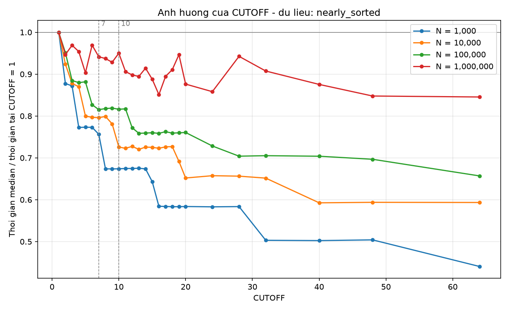

# Báo cáo thí nghiệm: Tìm giá trị CUTOFF tối ưu cho Mergesort

**Sinh viên:** Lê Duy Mạnh - MSV: 25020254
**Môn học:** Cấu trúc dữ liệu và giải thuật
**Ngày:** 17/11/2026

---

## 1. Mục tiêu

Mergesort có cải tiến dùng insertion sort cho mảng con nhỏ thay vì sử dụng đệ quy; giáo trình nêu CUTOFF = 7 (cũ) và 10 (mới); câu hỏi của thí nghiệm là giá trị nào phù hợp với máy của em, và vì sao phải đo thay vì chỉ dựa vào lý thuyết (chi phí thực tế phụ thuộc phần cứng, ngôn ngữ, JVM).

## 2. Cơ sở lý thuyết

- Mergesort dùng khoảng N log N phép so sánh, nhưng mỗi lần gọi đệ quy có chi phí cố định: gọi hàm, copy sang một mảng phụ `aux` sau đó merge 2 mảng con lại với nhau. 
- Insertion sort dùng khoảng n²/4 phép so sánh trên dữ liệu ngẫu nhiên, khoảng n trên dữ liệu đã sắp xếp, khoảng n²/2 trên dữ liệu đảo ngược; nhưng không có chi phí đệ quy và không cần mảng phụ.
- Vì vậy CUTOFF quá nhỏ thì lãng phí vào đệ quy, quá lớn thì phần bậc hai của insertion sort sẽ chiếm phần lớn thời gian. 
=> Dự đoán: thời gian theo CUTOFF có dạng chữ U, và vị trí đáy phụ thuộc kiểu dữ liệu.

## 3. Cài đặt
Mô tả code đã được cài đặt để thực hiện thí nghiệm **MergeSortCutOff**: 
- Sử dụng 1 hàm `merge` để merge 2 mảng con đã sắp xếp lại với nhau. 
- Một hàm `insertionSort` để sử dụng khi CUTOFF đạt đúng điều kiện, điều kiện này được kiểm tra trong hàm sort công khai. 
- Khi mảng đủ nhỏ để sử dụng InsertionSort trong đệ quy với điều kiện: `cuoi <= dau + cutoff - 1`, ta sẽ sử dụng InsertionSort để sắp xếp mảng con đó. 
- Nếu không đủ nhỏ thì tiếp tục đệ quy.


## 4. Phương pháp thí nghiệm

### 4.1. Cấu hình máy

| Thành phần | Giá trị |
|---|---|
| Máy / chip | Macbook Pro M1 Pro|
| Số nhân CPU | 10 |
| RAM | 32 GB |
| Hệ điều hành | macOS 26.7.3 (aarch64) |
| Java | Java HotSpot 25.0.2 |
| Heap JVM | 2048 MB (`-Xms2g -Xmx2g`) |
| Nguồn điện | cắm sạc |

### 4.2. Bộ dữ liệu

| Kiểu | Cách tạo | Mục đích |
|---|---|---|
| `random` | Số nguyên ngẫu nhiên | Trường hợp điển hình |
| `sorted` | Đã sắp xếp tăng dần | Trường hợp tốt nhất của insertion sort |
| `reversed` | Đã Sắp xếp giảm dần | Trường hợp xấu nhất của insertion sort |
| `nearly_sorted` | Đã sắp xếp, đổi chỗ ngẫu nhiên 1% số phần tử | Dữ liệu gần có thứ tự |
| `few_unique` | Có 10 giá trị khác nhau từ 0 đến 9 | Nhiều khóa trùng |

Mỗi kiểu có 4 kích thước N = 1.000; 10.000; 100.000; 1.000.000, tổng cộng 20 file trong `data/`. Dữ liệu sinh bằng `java.util.Random` với seed cố định `20261116`, nên có thể tái tạo chính xác.

### 4.3. Quy trình đo

**a. Chọn các giá trị CUTOFF cần kiểm tra:**
   * Vùng dày chạy từ `1-20 chứa 2 giá trị 7 và 10` có thể show ra đáy chữ U và cần độ phân giải cao để thấy chính xác chỗ nhảy bậc. 
   * Vùng thưa `24, 28, 32, 40, 48, 64` chỉ cần xác nhận đường cong đi lên lại. Đoạn con bị chia đôi nên càng về sau các bậc càng cách xa nhau (Dừng CUTOFF ở 64 vì CUTOFF 64 đã chậm hơn cả Mergesort thuần)

**b.Warm up để không chịu ảnh hưởng của JIT**
   * Java không chạy code ở tốc độ tối đa ngay từ đầu mà qua 2 giai đoạn: 
      1. Lúc mới chạy thì JVM (Máy ảo của Java) đọc bytecode trong file `.class` và thông dịch từng lệnh một (tốc độ chậm).
      2. Sau khi hàm đc gọi nhiều lần: JVM nhận ra hàm đó dùng thường xuyên (quá tải) sẽ biên dịch nó thành mã máy CPU và tối ưu thêm. Từ đó hàm chạy nhanh hơn nhiều lần. Cơ chế này gọi là JIT (Just-In-Time compilation, biên dịch đúng lúc cần).
   * Vì sao đo 25 lần: 
      - Kể khi đã warm-up, cùng một mảng và cùng một CUTOFF, mỗi lần đo vẫn ra số hơi khác: hệ điều hành chen việc khác vào, Java dừng lại dọn bộ nhớ, CPU đổi tốc độ theo nhiệt độ (Một lần đo có thể trúng lúc máy giật)
      - Đo 25 lần để lấy trung vị (xếp 25 số theo thứ tự, trung vị là số thứ 13) => các lần đo bật thường bị loại ra 1 cách tự nhiên. Cột `std_ms` trong `summary.csv` cho biết các lần dao động bao nhiêu. 

**c. Bấm giờ `System.nanoTime()` và copy mảng trước khi bấm giờ:**
   * `System.nanoTime()` trả về con số tính bằng nano giây (1 ns = 10^-9 giây). Hàm này được gọi trước khi sort và sau khi sort => dùng để tính ra thời gian sort (sau trừ đi trước). 
   * So với `System.currentTimeMillis()` (Độ phân giải mili s, sort mảng 1000 phần tử chỉ mất khoản 0,07ms nên đo ra 0, và có thể nhảy lùi khi máy chỉnh giờ), `nanoTime` được thiết kế để đo khoảng thời gian và luôn tăng đều. 
   * Sort làm thay đổi chính mảng được truyền vào vì nó sắp xếp tại chỗ. Nếu lần đo sau lại sort mảng sắp xếp từ trước thì sẽ sort nhanh hơn dẫn đến những CUTOFF nào được đo đầu tiên trông chậm nhất và các CUTOFF khác về sau sẽ đo sai dữ liệu dẫn đến sai toàn bộ thí nghiệm. 
   Vì vậy nên chương trình giữ một mảng gốc `base` không bao giờ bị sort và trước mỗi lần đo thì copy mảng `base` sang mảng `w` rồi sort `w`. Mọi CUTOFF và mọi lần đo đều bắt đầu từ cùng một dữ liệu.
   * Vì sao copy lại nằm ngoài khoảng thời gian bấm giờ: Nếu tính cả copy thì mọi phép đo cộng thêm cùng 1 khoảng thời gian, làm chênh lệch tương đối giữa các CUTOFF trông nhỏ đi và cột `ratio_vs_baseline` bị sai lệch. 
   * `System.arraycopy` là hàm có sẵn của Java, được JVM tối ưu nên nhanh hơn vòng `for` tự viết. 
   Đoạn code tương ứng trong hàm `timeOnce` của `CutoffBenchmark.java`:

      ```java
      for (Comparable[] w : work) System.arraycopy(base, 0, w, 0, base.length);

      long start = System.nanoTime();
      for (Comparable[] w : work) {
         MergeSortCutOff.sort(w, cutoff);
      }
      long elapsed = System.nanoTime() - start;
      ```

   * Dòng đầu copy mảng gốc sang các mảng làm việc. Lệnh `System.nanoTime()` thứ nhất chỉ được gọi sau đó, nên thời gian copy không bị tính vào `elapsed`.

**d. Kéo dài khoảng đo cho mảng nhỏ.**
   * Mỗi lần bấm giờ đều có một sai số không phụ thuộc vào thứ được đo: 
      - Lời gọi `System.nanoTime()` tốn thời gian, khoảng vài chục nano giây. 
      - Một sự kiện ngắt quãng (hệ điều hành có thể xử lý việc khác) rơi vào đúng khoảng đo.
   * Với mảng nhỏ, thời gian một lần sắp xếp quá `ngắn` so với sai số của đồng hồ, nên chương trình sắp xếp nhiều bản sao trong một lần bấm giờ rồi chia trung bình, để sai số được chia đều và trở nên không đáng kể.  
   * Vì sao khoảng đo `ngắn` lại có hại: Điều quan trọng là **sai số tương đối**, sai số chia cho thời gian đo được, cùng 1 sai số, khoảng đo càng ngắn thì tỉ lệ sai càng lớn, có thể lớn ngang chênh lệch giữa các CUTOFF (vài phần trăm) cần phân biệt. 
   Vì vậy, với mảng nhỏ, chương trình sắp xếp nhiều bản sao trong một lần bấm giờ rồi chia cho số bản sao. Khoảng đo dài ra nhiều lần, sai số được chia đều và trở nên không đáng kể, còn con số ghi lại vẫn là thời gian của một lần sắp xếp. Số bản sao được chọn để mỗi lần đo sắp xếp tổng cộng khoảng 200.000 phần tử:

      | N | Số bản sao | Tổng phần tử mỗi lần đo |
      |---|---|---|
      | 1.000 | 200 | 200.000 |
      | 10.000 | 20 | 200.000 |
      | 100.000 | 2 | 200.000 |
      | 1.000.000 | 1 | 1.000.000 |

   * Mỗi bản sao đều được copy từ mảng gốc `base` (mục c), nên mọi lần sắp xếp đều xuất phát từ cùng một dữ liệu.

     **Kiểm chứng bằng thí nghiệm đối chứng.** Để xem biện pháp này có tác dụng thật không, thí nghiệm được chạy lại với N = 1.000 và 10.000 nhưng mỗi lần bấm giờ chỉ sắp xếp một mảng, rồi so độ dao động của các lần đo (độ lệch chuẩn chia trung vị) với thí nghiệm chính. Kết quả với dữ liệu ngẫu nhiên:

      | N | CUTOFF | Gộp bản sao | Không gộp |
      |---|---|---|---|
      | 1.000 | 1 | 2,1% | 85,3% |
      | 1.000 | 7 | 2,1% | 70,5% |
      | 1.000 | 10 | 3,1% | 84,1% |
      | 10.000 | 1 | 0,6% | 0,8% |
      | 10.000 | 7 | 0,6% | 3,4% |
      | 10.000 | 10 | 0,6% | 1,9% |

   * Với N = 1.000, khi không gộp, độ dao động lên tới 70–85%, lớn gấp nhiều lần chênh lệch khoảng 5% giữa CUTOFF 7 và 10. Khi gộp 200 bản sao, độ dao động chỉ còn 2–3%, đủ nhỏ để phân biệt các CUTOFF.
   * Với N = 10.000, một lần sắp xếp đã mất hơn 1 ms nên khoảng đo vốn đủ dài; không gộp chỉ dao động 0,8–3,4%, và gộp vẫn giảm được xuống 0,6%. Hiệu quả của việc gộp giảm dần khi khoảng đo dài ra, đúng như lập luận ở trên.
   * Nhiễu cũng làm sai lệch kết luận: lần chạy không gộp chọn ra CUTOFF tốt nhất cho dữ liệu ngẫu nhiên là 12 (N = 1.000) và 28 (N = 10.000), trong khi thí nghiệm chính cho 19 ở cả hai kích thước.

   Do độ lệch chuẩn rất nhạy với vài lần đo bất thường, mức 70–85% chủ yếu phản ánh việc một số lần đo vọt lên gấp nhiều lần, không có nghĩa là mọi lần đo đều lệch như vậy.

   Cách chạy thí nghiệm đối chứng xem Phụ lục A; số liệu thô nằm trong thư mục

**e. Xáo thứ tự CUTOFF và dọn bộ nhớ trước mỗi vòng đo**

Thí nghiệm chạy 20–30 phút, và trong thời gian đó máy không ở trạng thái như nhau: CPU nóng dần, tác vụ nền của hệ điều hành bắt đầu hoặc kết thúc, rác tích tụ dần trong bộ nhớ. Hai biện pháp dưới đây cùng được thực hiện ở đầu mỗi vòng đo để những thay đổi này không làm lệch kết quả.

**Xáo thứ tự CUTOFF**

* *Vấn đề:* nếu luôn đo theo thứ tự cố định 1, 2, ..., 64 thì trong mỗi vòng, CUTOFF 64 luôn được đo sau cùng. Nếu máy chậm dần trong vòng, CUTOFF lớn sẽ luôn bị đo lúc máy chậm hơn và trông chậm hơn thực tế. Đây là sai lệch có hệ thống: lần đo nào cũng lệch về cùng một phía, nên lặp lại nhiều lần hay dùng trung vị cũng không loại bỏ được.
* *Cách xử lý:* trước mỗi vòng, 26 giá trị CUTOFF được xáo ngẫu nhiên bằng thuật toán Fisher–Yates, thuật toán xáo trộn mảng sao cho mọi thứ tự có thể xảy ra đều có xác suất như nhau. Sau 25 vòng, mỗi CUTOFF được đo ở đầu, giữa và cuối vòng với tần suất như nhau, nên sai lệch có hệ thống trở thành nhiễu ngẫu nhiên và được xử lý bằng việc lặp lại 25 lần.
* Bộ sinh số ngẫu nhiên dùng seed cố định (`ORDER_SEED = 42`), nên chạy lại thí nghiệm sẽ cho đúng cùng thứ tự đo, đảm bảo tính tái lập.

**Gọi `System.gc()` trước mỗi vòng**

* *Vấn đề:* mỗi lần gọi `new`, Java cấp một vùng nhớ trên heap. Khi không còn biến nào trỏ tới một đối tượng, đối tượng đó thành rác nhưng chưa được xóa ngay. Bộ thu gom rác (Garbage Collector, GC) tự chạy khi heap gần đầy để giải phóng bộ nhớ, và trong lúc dọn có thể tạm dừng chương trình. Thí nghiệm này sinh rất nhiều rác, vì mỗi lần sắp xếp đều cấp phát một mảng phụ mới:

  ```java
  Comparable[] aux = new Comparable[a.length];
  ```

  Nếu GC chạy đúng lúc đang bấm giờ, phép đo đó bị cộng thêm thời gian dọn rác, không liên quan gì đến CUTOFF.
* *Cách xử lý:* `System.gc()` yêu cầu Java dọn rác ngay lúc đó. Gọi nó trước mỗi vòng giúp heap sạch khi bắt đầu đo, nên GC ít có khả năng chen vào giữa các phép đo. Thời gian dọn rác nằm ngoài khoảng bấm giờ. Ngoài ra, lệnh chạy dùng `-Xms2g -Xmx2g` để cố định kích thước heap, tránh việc JVM co giãn heap giữa chừng.
* *Giới hạn:* `System.gc()` chỉ là lời đề nghị, JVM có quyền bỏ qua; và nó chỉ được gọi một lần mỗi vòng, trong khi mỗi vòng có 26 phép đo, nên GC vẫn có thể xảy ra trong lúc đo, nhất là với N = 1.000.000. Những lần đo đó trở thành giá trị bất thường, và đây là một lý do thí nghiệm dùng trung vị thay vì trung bình (mục f).

Đoạn code tương ứng trong `Benchmark.java`:

```java
for (int run = 0; run < runs; run++) {
    shuffle(order, orderRnd);   // Xáo thứ tự 26 CUTOFF.
    System.gc();                // Dọn bộ nhớ trước khi đo.
    for (int idx : order) {
        double ns = timeOnce(base, work, CUTOFFS[idx]);
        ...
    }
}
```
**f. Dùng trung vị làm số liệu chính; chỉ số so sánh là `ratio = median(CUTOFF) / median(CUTOFF = 1)`.**

**Vấn đề:** Mỗi lần đo đều có nhiễu, nên mỗi tổ hợp (kiểu dữ liệu, N, CUTOFF) được đo 25 lần và cần gom thành một con số đại diện. Trong benchmark, các lần đo bất thường gần như luôn lệch lên (GC hoặc hệ điều hành chen vào giữa phép đo), nên trung bình bị kéo lên theo. Ngoài ra, thời gian tuyệt đối chênh nhau hàng nghìn lần giữa các kích thước N, nên không so sánh trực tiếp được trên cùng một thang.

**Cách xử lý:**

* **Dùng trung vị làm số liệu chính.** Trung vị là giá trị đứng giữa sau khi xếp 25 lần đo theo thứ tự, nên vài lần đo vọt lên rất cao không làm thay đổi nó. Ví dụ với dữ liệu ngẫu nhiên, N = 100.000:

| CUTOFF | Trung vị (ms) | Trung bình (ms) | Độ lệch chuẩn (ms) |
|---|---|---|---|
| 14 | 16,337 | 16,328 | 0,199 |
| 15 | 16,438 | 17,115 | 3,515 |

  Độ lệch chuẩn của CUTOFF 15 lớn gấp khoảng 17 lần CUTOFF 14, cho thấy có lần đo bất thường. Theo trung bình, CUTOFF 15 chậm hơn CUTOFF 14 tới 4,8%; theo trung vị chỉ chậm hơn 0,6%, phản ánh đúng việc hai giá trị gần như ngang nhau.

* **So sánh bằng tỉ lệ với mergesort thuần:** `ratio = median(CUTOFF) / median(CUTOFF = 1)`. CUTOFF = 1 tương đương mergesort không dùng insertion sort, nên tỉ lệ cho biết trực tiếp mức lợi của cải tiến: ratio 0,88 nghĩa là nhanh hơn 12%, ratio lớn hơn 1 nghĩa là chậm hơn. Vì tỉ lệ không phụ thuộc thời gian tuyệt đối, các kích thước N khác nhau được so sánh trên cùng một thang và vẽ chung một đồ thị.

* **Độ lệch chuẩn được dùng để đánh giá ý nghĩa của chênh lệch:** khi chênh lệch giữa hai CUTOFF nhỏ hơn độ lệch chuẩn, không thể kết luận giá trị nào tốt hơn.

**Code minh họa:** tính trung vị và tỉ lệ trong `Benchmark.java`:

```java
private static double median(double[] x) {
    double[] s = x.clone();
    Arrays.sort(s);
    int m = s.length / 2;
    return (s.length % 2 == 1) ? s[m] : (s[m - 1] + s[m]) / 2.0;
}
```

```java
for (int i = 0; i < CUTOFFS.length; i++) {
    medians[i] = median(times[i]);
    if (CUTOFFS[i] == BASELINE_CUTOFF) baselineMedian = medians[i];  
}
// ratio_vs_baseline = medians[i] / baselineMedian
```

**Giới hạn:** mọi tỉ lệ của cùng một (kiểu dữ liệu, N) đều chia cho cùng một trung vị mốc, nên nếu số đo tại CUTOFF = 1 bị nhiễu thì cả đường dịch theo. Đây là một nguyên nhân các đường N = 1.000.000 trên đồ thị dao động mạnh.

**g. Kiểm tra tính đúng của kết quả sắp xếp**

**Vấn đề:** Thời gian đo được chỉ có ý nghĩa nếu đó là thời gian của một thuật toán sắp xếp đúng. Lỗi cú pháp thì trình biên dịch tự báo, nhưng lỗi logic (sai điều kiện trong `merge` hay `insertionSort`) thì chương trình vẫn chạy bình thường và vẫn in ra thời gian và không thồng báo gì. Nếu không kiểm tra, chúng ta không thể biết số đo là của một cài đặt đúng hay sai.

**Cách xử lý:** Benchmark kiểm tra ở hai lớp:

* **So với `Arrays.sort`:** `Arrays.sort` là hàm sắp xếp có sẵn của Java, đã được kiểm thử kỹ, nên được dùng làm đáp án chuẩn. Ở vòng warm-up đầu tiên, kết quả của `MergeSortCutOff` được so từng phần tử với đáp án, cho mọi CUTOFF trên mọi file dữ liệu (26 × 20 = 520 tổ hợp). Việc này diễn ra trước các lần đo chính thức.
* **Kiểm tra mảng đã có thứ tự (`isSorted`):** sau mỗi lần đo, chương trình duyệt mảng được sao chép cuối cùng vừa được sắp xếp để kiểm tra các phần tử theo thứ tự tăng dần

Cần cả hai lớp vì `isSorted` chỉ kiểm tra thứ tự, không phát hiện được phần tử bị mất hay bị nhân đôi: nếu một lỗi biến mảng `[5, 3, 8, 1]` thành `[1, 1, 1, 1]`, mảng vẫn "đã sắp xếp" nhưng sai hoàn toàn. Phép so với `Arrays.sort` bắt được lỗi này nhưng tốn thời gian hơn, nên chỉ chạy một lần cho mỗi tổ hợp; `isSorted` là chốt chặn rẻ cho mọi lần đo còn lại.

Nếu phát hiện sai, chương trình dừng ngay và báo CUTOFF nào cho kết quả sai, thay vì âm thầm ghi số liệu sai vào `raw.csv`.

**Code minh họa:** So với `Arrays.sort` ở vòng warm-up đầu:

```java
Integer[] expected = base.clone();
Arrays.sort(expected);  // Phần ra kết quả chuẩn. 

for (int round = 0; round < warmupRounds; round++) {
    for (int cutoff : CUTOFFS) {
        timeOnce(base, work, cutoff);
        if (round == 0 && !Arrays.equals(work[0], expected)) {
            throw new IllegalStateException("Ket qua SAI voi cutoff=" + cutoff);
        }
    }
}
```

Kiểm tra thứ tự sau mỗi lần đo, trong hàm `timeOnce`:

```java
long elapsed = System.nanoTime() - start; // Dừng đồng hồ đo trước 
if (!isSorted(work[work.length - 1])) {
    throw new IllegalStateException("Mang chua duoc sap xep voi cutoff = " + cutoff);
}
```

**Kết quả:** Thí nghiệm chính chạy trọn vẹn đến bảng tổng kết mà không bị dừng, nghĩa là kết quả của `MergeSortCutOff` khớp với `Arrays.sort` trên toàn bộ dữ liệu thí nghiệm.

**Thí nghiệm minh họa: nếu cài đặt có lỗi thì sao?** Để thấy vì sao không thể chỉ nhìn thời gian mà biết cài đặt đúng hay sai, một bản lỗi được tạo từ chính `MergeSortCutOff.java`, chỉ khác một dòng: thêm `if (true) return;` vào đầu `insertionSort`, khiến hàm thoát ngay mà không sắp xếp gì. Kết quả đo trên 10.000 số ngẫu nhiên:

| CUTOFF | Bản đúng (ms) | Bản lỗi (ms) | Bản lỗi sắp xếp đúng? |
|---|---|---|---|
| 1 | 1,432 | 1,358 | ĐÚNG |
| 4 | 1,372 | 1,092 | SAI |
| 7 | 1,291 | 0,890 | SAI |
| 10 | 1,243 | 0,718 | SAI |
| 16 | 1,248 | 0,714 | SAI |
| 32 | 1,224 | 0,584 | SAI |
| 64 | 1,289 | 0,486 | SAI |

* Bản lỗi nhanh dần khi CUTOFF tăng, đến CUTOFF 64 nhanh gấp khoảng 2,7 lần bản đúng, vì càng nhiều đoạn con được giao cho một hàm không làm gì. Nếu không kiểm tra tính đúng, đồ thị sẽ dẫn tới kết luận sai rằng CUTOFF càng lớn càng tốt.
* Ở CUTOFF = 1, bản lỗi vẫn cho kết quả đúng: các đoạn con dài 1 đã được điều kiện `if (cuoi <= dau) return;` xử lý trước, nên `insertionSort` không bao giờ được gọi và lỗi bị che. Vì vậy cần kiểm tra ở mọi giá trị CUTOFF, không chỉ một.
* `isSorted` phát hiện bản lỗi ở tất cả các CUTOFF đã thử, trừ CUTOFF = 1, nên `Benchmark` sẽ dừng ngay nếu gặp cài đặt này.

Cách tạo bản lỗi và chạy thí nghiệm minh họa xem Phụ lục B.

## 5. Kết quả

### 5.1. So sánh CUTOFF = 7 và CUTOFF = 10

Thời gian trung vị (ms) và tỉ lệ so với mergesort thuần (trong ngoặc). Cột "Tốt nhất" là CUTOFF có trung vị nhỏ nhất trong 26 giá trị.

**Dữ liệu ngẫu nhiên**

| N | CUTOFF = 1 | CUTOFF = 7 | CUTOFF = 10 | Tốt nhất | Độ lệch chuẩn tại 10 |
|---|---|---|---|---|---|
| 1.000 | 0,0852 | 0,0732 (0,859) | 0,0696 (0,816) | 19 (0,795) | 3,1% |
| 10.000 | 1,408 | 1,268 (0,900) | 1,235 (0,877) | 19 (0,874) | 0,6% |
| 100.000 | 18,02 | 16,55 (0,918) | 16,61 (0,922) | 14 (0,907) | 1,2% |
| 1.000.000 | 517,3 | 500,5 (0,968) | 491,5 (0,950) | 17 (0,928) | 7,9% |

**Các kiểu dữ liệu khác (tỉ lệ so với CUTOFF = 1)**

| Kiểu | N | CUTOFF = 7 | CUTOFF = 10 | Tốt nhất |
|---|---|---|---|---|
| `few_unique` | 1.000 | 0,786 | 0,765 | 11 (0,754) |
| | 10.000 | 0,861 | 0,832 | 17 (0,827) |
| | 100.000 | 0,883 | 0,884 | 17 (0,864) |
| | 1.000.000 | 0,958 | 1,006 | 8 (0,901) |
| `reversed` | 1.000 | 0,870 | 0,916 | 4 (0,863) |
| | 10.000 | 0,930 | 1,024 | 6 (0,918) |
| | 100.000 | 0,954 | 0,960 | 5 (0,946) |
| | 1.000.000 | 0,986 | 0,955 | 2 (0,922) |
| `sorted` | 1.000 | 0,743 | 0,659 | 64 (0,371) |
| | 10.000 | 0,804 | 0,737 | 48 (0,599) |
| | 100.000 | 0,859 | 0,857 | 64 (0,723) |
| | 1.000.000 | 0,991 | 0,984 | 48 (0,916) |
| `nearly_sorted` | 1.000 | 0,756 | 0,674 | 64 (0,441) |
| | 10.000 | 0,796 | 0,726 | 40 (0,593) |
| | 100.000 | 0,815 | 0,816 | 64 (0,657) |
| | 1.000.000 | 0,942 | 0,950 | 64 (0,845) |

Số liệu đầy đủ của 520 tổ hợp: `results/summary.csv`.
Lưu ý: cột `Tốt nhất` chỉ là giá trị có trung vị nhỏ nhất, nhiều khi chỉ hơn các CUTOFF lân cận vài phần nghìn, nhỏ hơn độ lệch chuẩn. Với N = 1.000.000, độ lệch chuẩn khoảng 6–15% nên cột này không có ý nghĩa. Với `sorted` và `nearly_sorted`, giá trị 48–64 nằm ở cuối khoảng đã thử, nên giá trị tối ưu thật có thể còn lớn hơn.

### 5.2. Ảnh hưởng của CUTOFF theo từng kiểu dữ liệu

Trục ngang là CUTOFF, trục dọc là tỉ lệ thời gian so với CUTOFF = 1; đường nằm dưới 1,0 nghĩa là nhanh hơn mergesort thuần. Hai vạch dọc đánh dấu CUTOFF = 7 và 10.


**Dữ liệu ngẫu nhiên.** Với N ≤ 100.000, tỉ lệ giảm nhanh khi CUTOFF tăng từ 1, đi ngang ở một vùng đáy rộng, rồi tăng lại. Vùng đáy: N = 1.000 ở khoảng 0,80 với CUTOFF 8–28; N = 10.000 ở khoảng 0,875 với CUTOFF 10–32; N = 100.000 ở khoảng 0,91 với CUTOFF 12–20. Ở CUTOFF 64, cả ba đường đều đã lên gần hoặc vượt 1 (N = 1.000: 1,21). Đường N = 1.000.000 dao động trong khoảng 0,93–0,99, không có hình dạng rõ ràng.


**Dữ liệu nhiều khóa trùng.** Hình dạng giống dữ liệu ngẫu nhiên. Vùng đáy: N = 1.000 ở khoảng 0,75–0,76 với CUTOFF 8–14; N = 10.000 ở khoảng 0,83 với CUTOFF 10–18; N = 100.000 ở khoảng 0,86 với CUTOFF 13–20. Đường N = 1.000.000 dao động mạnh.


**Dữ liệu đảo ngược.** Tỉ lệ chỉ dưới 1 với CUTOFF nhỏ: đến CUTOFF 14 (N = 1.000), 9 (N = 10.000) và 11 (N = 100.000). Sau đó tăng mạnh theo từng bậc, tới 2,81 ở CUTOFF 64 với N = 1.000, tức chậm gần gấp ba mergesort thuần.


**Dữ liệu đã sắp xếp.** Tỉ lệ giảm liên tục theo từng bậc đến CUTOFF 64, chưa có dấu hiệu tăng lại: N = 1.000 xuống 0,37; N = 10.000 khoảng 0,60; N = 100.000 khoảng 0,72. Đường N = 1.000.000 dao động quanh 0,92–1,02.



**Dữ liệu gần sắp xếp.** Giống dữ liệu đã sắp xếp: giảm theo bậc đến CUTOFF 64, xuống 0,44 (N = 1.000), 0,59 (N = 10.000), 0,66 (N = 100.000) và 0,85 (N = 1.000.000).

**Nhận xét chung.** Trên mọi hình, các đường N ≤ 100.000 không thay đổi đều mà đi ngang từng đoạn rồi nhảy bậc, và vị trí các bậc khác nhau giữa các N. Đường N = 1.000.000 luôn dao động mạnh hơn hẳn ba đường còn lại.


### 5.3. Thời gian chạy theo N


Dữ liệu ngẫu nhiên, thời gian trung vị (ms):

| CUTOFF | N = 1.000 | N = 10.000 | N = 100.000 | N = 1.000.000 |
|---|---|---|---|---|
| 1 | 0,085 | 1,408 | 18,02 | 517,3 |
| 7 | 0,073 | 1,268 | 16,55 | 500,5 |
| 10 | 0,070 | 1,235 | 16,61 | 491,5 |

Tỉ số thời gian khi N tăng 10 lần (CUTOFF = 10), so với tỉ số lý thuyết của N log N:

| Bước | Đo được | Lý thuyết N log N |
|---|---|---|
| 1.000 → 10.000 | 17,8 | 13,3 |
| 10.000 → 100.000 | 13,5 | 12,5 |
| 100.000 → 1.000.000 | 29,6 | 12,0 |

## 6. Phân tích


## 7. Hạn chế

* **Nhiễu lớn ở N = 1.000.000.** Độ lệch chuẩn khoảng 6–15% trung vị, lớn hơn chênh lệch giữa các CUTOFF (2–5%), nên không rút ra được kết luận nào cho kích thước này.
* **Chỉ thử N là lũy thừa của 10.** Do hiệu ứng bậc thang, CUTOFF tốt nhất phụ thuộc vào độ dài các đoạn con mà N tạo ra; với N khác (ví dụ 1.500 hay 70.000), kết quả có thể khác.
* **Mỗi tổ hợp (kiểu dữ liệu, N) chỉ dùng một mảng.** Kết quả có thể phụ thuộc phần nào vào mảng cụ thể được sinh ra; chưa thử với nhiều mảng khác seed.
* **CUTOFF lớn nhất được thử là 64.** Với dữ liệu đã sắp xếp và gần sắp xếp, đường cong vẫn đang giảm ở 64 nên chưa tìm được giá trị tối ưu.
* **Chỉ đo trên một máy.** Chip Apple Silicon có cả nhân hiệu năng và nhân tiết kiệm điện; hệ điều hành có thể chuyển tiến trình giữa hai loại nhân trong lúc đo. Kết quả trên máy khác có thể khác.
* **Dùng `Integer[]` thay vì `int[]`.** Mỗi phép so sánh phải gọi `compareTo` trên đối tượng, nên thời gian tuyệt đối và có thể cả CUTOFF tối ưu sẽ khác với mảng số nguyên nguyên thủy.
* **`System.gc()` không chặn được hoàn toàn việc dọn rác trong lúc đo** (mục 4.3e), đặc biệt khi mỗi lần sắp xếp N = 1.000.000 cấp phát một mảng phụ khoảng 4 MB.
* **Giả thuyết về bộ nhớ đệm ở N lớn chưa được kiểm chứng** (mục 6f).

## 8. Kết luận

## Phụ lục

### Phụ lục A. Thí nghiệm đối chứng cho mục 4.3d

**Mục đích.** Kiểm tra tác dụng của việc gộp nhiều bản sao trong một lần bấm giờ, bằng cách đo lại khi mỗi lần bấm giờ chỉ sắp xếp một mảng.

**Cách chạy.**

1. Tạm sửa hai hằng số trong `Benchmark.java`:
   ```java
   static final int[] SIZES = {1_000, 10_000};
   static final int MIN_ELEMENTS_PER_MEASUREMENT = 1;   // mỗi lần đo chỉ sắp xếp 1 mảng
   ```
2. Biên dịch và chạy, ghi kết quả vào thư mục riêng để không đè kết quả chính:
   ```
   javac *.java
   java Benchmark 25 5 data results_single
   ```
3. Sửa hai hằng số về giá trị ban đầu (`{1_000, 10_000, 100_000, 1_000_000}` và `200_000`) rồi biên dịch lại.
4. So sánh độ dao động bằng `python3 compare.py`.

**Script so sánh (`compare.py`).** Với dữ liệu ngẫu nhiên và CUTOFF 1, 7, 10, script đọc `summary.csv` của cả hai thư mục và tính hệ số biến thiên, tức độ lệch chuẩn chia trung vị, tính theo phần trăm:

```python
def cv(path):
    out = {}
    with open(path, newline="") as f:
        for r in csv.DictReader(f):
            if r["data_type"] == "random" and r["cutoff"] in CUTOFFS:
                out[(int(r["n"]), int(r["cutoff"]))] = 100 * float(r["std_ms"]) / float(r["median_ms"])
    return out
```

Dùng tỉ lệ thay vì độ lệch chuẩn tuyệt đối để so sánh được giữa các kích thước N khác nhau: cùng một độ lệch 0,1 ms còn lớn hơn cả thời gian một lần sắp xếp với N = 1.000 (khoảng 0,08 ms), nhưng chỉ bằng khoảng 7% thời gian sắp xếp với N = 10.000 (khoảng 1,4 ms). Mã nguồn đầy đủ: `compare.py`; số liệu thô: `results_single/`.

### Phụ lục B. Thí nghiệm minh họa cho mục 4.3g

**Mục đích.** Cho thấy một cài đặt có lỗi logic vẫn chạy bình thường và vẫn cho ra thời gian đo, thậm chí còn nhanh hơn cài đặt đúng, nên không thể chỉ nhìn thời gian mà biết cài đặt đúng hay sai.

**Cách tạo bản lỗi.** `brokendemo/BrokenSort.java` là bản sao của `MergeSortCutOff.java`, chỉ khác hai chỗ:

1. Tên lớp đổi thành `BrokenSort`.
2. Thêm một dòng vào đầu hàm `insertionSort`, khiến hàm thoát ngay mà không sắp xếp gì:
   ```java
   if (true) return;
   ```

**Cách đo.** `brokendemo/BrokenDemo.java` là chương trình chạy thí nghiệm. Nó gọi cả bản đúng (`MergeSortCutOff`) và bản lỗi (`BrokenSort`) trên cùng một mảng 10.000 số nguyên ngẫu nhiên (seed 1), với CUTOFF 1, 4, 7, 10, 16, 32, 64. Mỗi lần bấm giờ sắp xếp 20 bản sao; chạy bỏ 5 lần warm-up rồi lấy trung vị của 25 lần đo. Sau đó kiểm tra kết quả của bản lỗi bằng `isSorted`.

**Cách chạy** (đứng ở thư mục project):

```
javac -d brokendemo/out MergeSortCutOff.java brokendemo/*.java
java -cp brokendemo/out BrokenDemo
```

Tùy chọn `-d brokendemo/out` gom toàn bộ file `.class` vào một thư mục riêng, tách khỏi thí nghiệm chính. Kết quả xem bảng trong mục 4.3f.

### Phụ lục C. Danh mục tệp

| Loại | Tệp |
|---|---|
| Mã nguồn | `MergeSortCutOff.java`, `Data.java`, `Benchmark.java`, `plot.py`, `compare.py` |
| Dữ liệu | `data/` (20 tệp, seed `20261116`) |
| Kết quả thí nghiệm chính | `results/raw.csv`, `results/summary.csv`, `results/environment.txt`, `results/*.png` |
| Kết quả đối chứng | `results_single/` |
| Thí nghiệm minh họa | `brokendemo/BrokenSort.java`, `brokendemo/BrokenDemo.java` |
| Hướng dẫn chạy lại | `README.md` |
| Log trao đổi với AI | `ai-chat-log/` |

### Phụ lục D. Sử dụng AI
- Sử dụng AI: (Các script đo, sinh dữ liệu và vẽ đồ thị được viết với sự hỗ trợ của AI; cài đặt mergesort do em tự viết từ slide bài giảng và bản Report được viết dưới sự hiểu biết về thí nghiệm của em). 