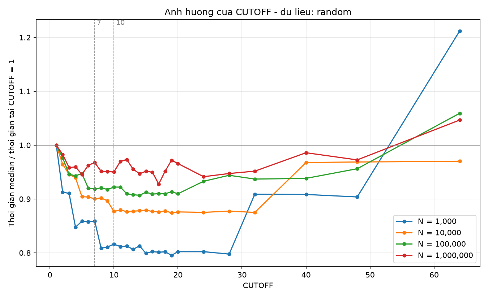
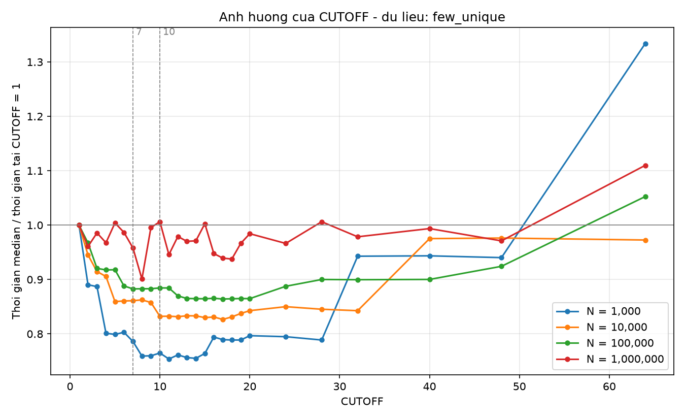

# Báo cáo thí nghiệm: Tìm giá trị CUTOFF tối ưu cho Mergesort

**Sinh viên:** Lê Duy Mạnh - MSV: 25020254
**Môn học:** Cấu trúc dữ liệu và giải thuật
**Ngày:** 17/11/2026

---

## 1. Mục tiêu

Mergesort có cải tiến dùng insertion sort cho mảng con nhỏ thay vì sử dụng đệ quy; giáo trình nêu CUTOFF = 7 (cũ) và 10 (mới); câu hỏi của thí nghiệm là giá trị nào phù hợp với máy của em, và vì sao phải đo thay vì chỉ dựa vào lý thuyết (chi phí thực tế phụ thuộc phần cứng, ngôn ngữ, JVM).

## 2. Cơ sở lý thuyết

- Mergesort dùng khoảng N log N phép so sánh, nhưng mỗi lần gọi đệ quy có chi phí cố định: gọi hàm, copy sang một mảng phụ `aux` sau đó merge 2 mảng con lại với nhau. 
- Insertion sort dùng khoảng n²/4 phép so sánh trên dữ liệu ngẫu nhiên, khoảng n trên dữ liệu đã sắp xếp, khoảng n²/2 trên dữ liệu đảo ngược; nhưng không có chi phí đệ quy và không cần mảng phụ.
- Vì vậy CUTOFF quá nhỏ thì lãng phí vào đệ quy, quá lớn thì phần bậc hai của insertion sort sẽ chiếm phần lớn thời gian. 
=> Dự đoán: thời gian theo CUTOFF có dạng chữ U, và vị trí đáy phụ thuộc kiểu dữ liệu.

## 3. Cài đặt
Mô tả code đã được cài đặt để thực hiện thí nghiệm **MergeSortCutOff**: 
- Sử dụng 1 hàm `merge` để merge 2 mảng con đã sắp xếp lại với nhau. 
- Một hàm `insertionSort` để sử dụng khi CUTOFF đạt đúng điều kiện, điều kiện này được kiểm tra trong hàm sort công khai. 
- Khi mảng đủ nhỏ để sử dụng InsertionSort trong đệ quy với điều kiện: `cuoi <= dau + cutoff - 1`, ta sẽ sử dụng InsertionSort để sắp xếp mảng con đó. 
- Nếu không đủ nhỏ thì tiếp tục đệ quy.


## 4. Phương pháp thí nghiệm

### 4.1. Cấu hình máy

| Thành phần | Giá trị |
|---|---|
| Máy / chip | Macbook Pro M1 Pro|
| Số nhân CPU | 10 |
| RAM | 32 GB |
| Hệ điều hành | macOS 26.7.3 (aarch64) |
| Java | Java HotSpot 25.0.2 |
| Heap JVM | 2048 MB (`-Xms2g -Xmx2g`) |
| Nguồn điện | cắm sạc |

### 4.2. Bộ dữ liệu

| Kiểu | Cách tạo | Mục đích |
|---|---|---|
| `random` | Số nguyên ngẫu nhiên | Trường hợp điển hình |
| `sorted` | Đã sắp xếp tăng dần | Trường hợp tốt nhất của insertion sort |
| `reversed` | Đã Sắp xếp giảm dần | Trường hợp xấu nhất của insertion sort |
| `nearly_sorted` | Đã sắp xếp, đổi chỗ ngẫu nhiên 1% số phần tử | Dữ liệu gần có thứ tự |
| `few_unique` | Có 10 giá trị khác nhau từ 0 đến 9 | Nhiều khóa trùng |

Mỗi kiểu có 4 kích thước N = 1.000; 10.000; 100.000; 1.000.000, tổng cộng 20 file trong `data/`. Dữ liệu sinh bằng `java.util.Random` với seed cố định `20261116`, nên có thể tái tạo chính xác.

### 4.3. Quy trình đo

**a. Chọn các giá trị CUTOFF cần kiểm tra:**
   * Vùng dày chạy từ `1-20 chứa 2 giá trị 7 và 10` có thể show ra đáy chữ U và cần độ phân giải cao để thấy chính xác chỗ nhảy bậc. 
   * Vùng thưa `24, 28, 32, 40, 48, 64` chỉ cần xác nhận đường cong đi lên lại. Đoạn con bị chia đôi nên càng về sau các bậc càng cách xa nhau (Dừng CUTOFF ở 64 vì CUTOFF 64 đã chậm hơn cả Mergesort thuần)

**b.Warm up để không chịu ảnh hưởng của JIT**
   * Java không chạy code ở tốc độ tối đau ngay từ đầu mà qua 2 giai đoạn: 
      1. Lúc mới chạy thì JVM (Máy ảo của Java) đọc bytecode trong file `.class` và thông dịch từng lệnh một (tốc độ chậm).
      2. Sau khi hàm đc gọi nhiều lần: JVM nhận ra hàm đó dùng thường xuyên (quá tải) sẽ biên dịch nó thành mã máy CPU và tối ưu thêm. Từ đó hàm chạy nhanh hơn nhiều lần. Cơ chế này gọi là JIT (Just-In-Time compliation, biên dịch đúng lúc cần).
   * Vì sao đo 25 lần: 
      - Kể khi đã warm-up, cùng một mảng và cùng một CUTOFF, mỗi lần đo vẫn ra số hơi khác: hệ điều hành chen việc khác vào, Java dừng lại dọn bộ nhớ, CPU đổi tốc độ theo nhiệt độ (Một lần đo có thể trúng lúc máy giật)
      - Đo 25 lần để lấy trung vị (xếp 25 số theo thứ tự, trung vị là số thứ 13) => các lần đo bật thường bị loại ra 1 cách tự nhiên. Cột `std_ms` trong `summary.csv` cho biết các lần dao động bao nhiêu. 

**c. Bấm giờ `System.nanoTime()` và copy mảng trước khi bấm giờ:**
   * `System.nanoTime()` trả về con số tính bằng nano giây (1 ns = 10^-9 giây). Hàm này được gọi trước khi sort và sau khi sort => dùng để tính ra thời gian sort (sau trừ đi trước). 
   * So với `System.currentTimeMillis()` (Độ phân giải mili s, sort mảng 1000 phần tử chỉ mất khoản 0,07ms nên đo ra 0, và có thể nhảy lùi khi máy chỉnh giờ), `nanoTime` được thiết kế để đo khoảng thời gian và luôn tăng đều. 
   * Sort làm thay đổi chính mảng được truyền vào vì nó sắp xếp tại chỗ. Nếu lần đo sau lại sort mảng sắp xếp từ trước thì sẽ sort nhanh hơn dẫn đến những CUTOFF nào được đo đầu tiên trông chậm nhất và các CUTOFF khác về sau sẽ đo sai dữ liệu dẫn đến sai toàn bộ thí nghiệm. 
   Vì vậy nên chương trình giữ một mảng gốc `base` không bao giờ bị sort và trước mỗi lần đo thì copy mảng `base` sang mảng `w` rồi sort `w`. Mọi CUTOFF và mọi lần đo đều bắt đầu từ cùng một dữ liệu.
   * Vì sao copy lại nằm ngoài khoảng thời gian bấm giờ: Nếu tính cả copy thì mọi phép đo cộng thêm cùng 1 khoảng thời gian, làm chênh lệch tương đối giữa các CUTOFF trông nhỏ đi và cột `ratio_vs_baseline` bị sai lệch. 
   * `System.arraycopy` là hàm có sẵn của Java, được JVM tối ưu nên nhanh hơn vòng `for` tự viết. 
   Đoạn code tương ứng trong hàm `timeOnce` của `CutoffBenchmark.java`:

      ```java
      for (Comparable[] w : work) System.arraycopy(base, 0, w, 0, base.length);

      long start = System.nanoTime();
      for (Comparable[] w : work) {
         MergeSortCutOff.sort(w, cutoff);
      }
      long elapsed = System.nanoTime() - start;
      ```

   * Dòng đầu copy mảng gốc sang các mảng làm việc. Lệnh `System.nanoTime()` thứ nhất chỉ được gọi sau đó, nên thời gian copy không bị tính vào `elapsed`.

**d. Kéo dài khoảng đo cho mảng nhỏ.**
   * Mỗi lần bấm giờ đều có một sai số không phụ thuộc vào thứ được đo: 
      - Lời gọi `System.nanoTime()` tốn thời gian, khoảng vài chục nano giây. 
      - Một sự kiện ngắt quãng (hệ điều hành có thể xử lý việc khác) rơi vào đúng khoảng đo.
   * Với mảng nhỏ, thời gian một lần sắp xếp quá `ngắn` so với sai số của đồng hồ, nên chương trình sắp xếp nhiều bản sao trong một lần bấm giờ rồi chia trung bình, để sai số được chia đều và trở nên không đáng kể.  
   * Vì sao khoảng đo `ngắn` lại có hại: Điều quan trọng là **sai số tương đối**, sai số chia cho thời gian đo được, cùng 1 sai số, khoảng đo càng ngắn thì tỉ lệ sai càng lớn, có thể lớn ngang chênh lệch giữa các CUTOFF (vài phần trăm) cần phân biệt. 
   Vì vậy, với mảng nhỏ, chương trình sắp xếp nhiều bản sao trong một lần bấm giờ rồi chia cho số bản sao. Khoảng đo dài ra nhiều lần, sai số được chia đều và trở nên không đáng kể, còn con số ghi lại vẫn là thời gian của một lần sắp xếp. Số bản sao được chọn để mỗi lần đo sắp xếp tổng cộng khoảng 200.000 phần tử:

      | N | Số bản sao | Tổng phần tử mỗi lần đo |
      |---|---|---|
      | 1.000 | 200 | 200.000 |
      | 10.000 | 20 | 200.000 |
      | 100.000 | 2 | 200.000 |
      | 1.000.000 | 1 | 1.000.000 |

   * Mỗi bản sao đều được copy từ mảng gốc `base` (mục c), nên mọi lần sắp xếp đều xuất phát từ cùng một dữ liệu.

     **Kiểm chứng bằng thí nghiệm đối chứng.** Để xem biện pháp này có tác dụng thật không, thí nghiệm được chạy lại với N = 1.000 và 10.000 nhưng mỗi lần bấm giờ chỉ sắp xếp một mảng, rồi so độ dao động của các lần đo (độ lệch chuẩn chia trung vị) với thí nghiệm chính. Kết quả với dữ liệu ngẫu nhiên:

      | N | CUTOFF | Gộp bản sao | Không gộp |
      |---|---|---|---|
      | 1.000 | 1 | 2,1% | 85,3% |
      | 1.000 | 7 | 2,1% | 70,5% |
      | 1.000 | 10 | 3,1% | 84,1% |
      | 10.000 | 1 | 0,6% | 0,8% |
      | 10.000 | 7 | 0,6% | 3,4% |
      | 10.000 | 10 | 0,6% | 1,9% |

   * Với N = 1.000, khi không gộp, độ dao động lên tới 70–85%, lớn gấp nhiều lần chênh lệch khoảng 5% giữa CUTOFF 7 và 10. Khi gộp 200 bản sao, độ dao động chỉ còn 2–3%, đủ nhỏ để phân biệt các CUTOFF.
   * Với N = 10.000, một lần sắp xếp đã mất hơn 1 ms nên khoảng đo vốn đủ dài; không gộp chỉ dao động 0,8–3,4%, và gộp vẫn giảm được xuống 0,6%. Hiệu quả của việc gộp giảm dần khi khoảng đo dài ra, đúng như lập luận ở trên.
   * Nhiễu cũng làm sai lệch kết luận: lần chạy không gộp chọn ra CUTOFF tốt nhất cho dữ liệu ngẫu nhiên là 12 (N = 1.000) và 28 (N = 10.000), trong khi thí nghiệm chính cho 19 ở cả hai kích thước.

   Do độ lệch chuẩn rất nhạy với vài lần đo bất thường, mức 70–85% chủ yếu phản ánh việc một số lần đo vọt lên gấp nhiều lần, không có nghĩa là mọi lần đo đều lệch như vậy.

   Cách chạy thí nghiệm đối chứng xem Phụ lục A; số liệu thô nằm trong thư mục

**e. Xáo thứ tự CUTOFF ở mỗi vòng; gọi `System.gc()` trước mỗi vòng.**

**f. Kiểm tra tính đúng bằng cách so với `Arrays.sort`.**

**g. Dùng trung vị làm số liệu chính; chỉ số so sánh là `ratio = median(CUTOFF) / median(CUTOFF = 1)`.**

## 5. Kết quả

### 5.1. So sánh CUTOFF = 7 và CUTOFF = 10

Thời gian trung vị (ms) và tỉ lệ so với mergesort thuần (trong ngoặc). Cột "Tốt nhất" là CUTOFF có trung vị nhỏ nhất trong 26 giá trị.

**Dữ liệu ngẫu nhiên**

| N | CUTOFF = 1 | CUTOFF = 7 | CUTOFF = 10 | Tốt nhất | Độ lệch chuẩn tại 10 |
|---|---|---|---|---|---|
| 1.000 | 0,0852 | 0,0732 (0,859) | 0,0696 (0,816) | 19 (0,795) | 3,1% |
| 10.000 | 1,408 | 1,268 (0,900) | 1,235 (0,877) | 19 (0,874) | 0,6% |
| 100.000 | 18,02 | 16,55 (0,918) | 16,61 (0,922) | 14 (0,907) | 1,2% |
| 1.000.000 | 517,3 | 500,5 (0,968) | 491,5 (0,950) | 17 (0,928) | 7,9% |

**Các kiểu dữ liệu khác (tỉ lệ so với CUTOFF = 1)**

| Kiểu | N | CUTOFF = 7 | CUTOFF = 10 | Tốt nhất |
|---|---|---|---|---|
| `few_unique` | 1.000 | 0,786 | 0,765 | 11 (0,754) |
| | 10.000 | 0,861 | 0,832 | 17 (0,827) |
| | 100.000 | 0,883 | 0,884 | 17 (0,864) |
| | 1.000.000 | 0,958 | 1,006 | 8 (0,901) |
| `reversed` | 1.000 | 0,870 | 0,916 | 4 (0,863) |
| | 10.000 | 0,930 | 1,024 | 6 (0,918) |
| | 100.000 | 0,954 | 0,960 | 5 (0,946) |
| | 1.000.000 | 0,986 | 0,955 | 2 (0,922) |
| `sorted` | 1.000 | 0,743 | 0,659 | 64 (0,371) |
| | 10.000 | 0,804 | 0,737 | 48 (0,599) |
| | 100.000 | 0,859 | 0,857 | 64 (0,723) |
| | 1.000.000 | 0,991 | 0,984 | 48 (0,916) |
| `nearly_sorted` | 1.000 | 0,756 | 0,674 | 64 (0,441) |
| | 10.000 | 0,796 | 0,726 | 40 (0,593) |
| | 100.000 | 0,815 | 0,816 | 64 (0,657) |
| | 1.000.000 | 0,942 | 0,950 | 64 (0,845) |

Số liệu đầy đủ của 520 tổ hợp: `results/summary.csv`.

### 5.2. Ảnh hưởng của CUTOFF theo từng kiểu dữ liệu





### 5.3. Thời gian chạy theo N


Dữ liệu ngẫu nhiên, thời gian trung vị (ms):

| CUTOFF | N = 1.000 | N = 10.000 | N = 100.000 | N = 1.000.000 |
|---|---|---|---|---|
| 1 | 0,085 | 1,408 | 18,02 | 517,3 |
| 7 | 0,073 | 1,268 | 16,55 | 500,5 |
| 10 | 0,070 | 1,235 | 16,61 | 491,5 |

Tỉ số thời gian khi N tăng 10 lần (CUTOFF = 10), so với tỉ số lý thuyết của N log N:

| Bước | Đo được | Lý thuyết N log N |
|---|---|---|
| 1.000 → 10.000 | 17,8 | 13,3 |
| 10.000 → 100.000 | 13,5 | 12,5 |
| 100.000 → 1.000.000 | 29,6 | 12,0 |

## 6. Phân tích

## 7. Hạn chế

## 8. Kết luận

## Phụ lục

### Phụ lục A. Thí nghiệm đối chứng cho mục 4.3d

**Mục đích.** Kiểm tra tác dụng của việc gộp nhiều bản sao trong một lần bấm giờ, bằng cách đo lại khi mỗi lần bấm giờ chỉ sắp xếp một mảng.

**Cách chạy.**

1. Tạm sửa hai hằng số trong `Benchmark.java`:
   ```java
   static final int[] SIZES = {1_000, 10_000};
   static final int MIN_ELEMENTS_PER_MEASUREMENT = 1;   // mỗi lần đo chỉ sắp xếp 1 mảng
   ```
2. Biên dịch và chạy, ghi kết quả vào thư mục riêng để không đè kết quả chính:
   ```
   javac *.java
   java Benchmark 25 5 data results_single
   ```
3. Sửa hai hằng số về giá trị ban đầu (`{1_000, 10_000, 100_000, 1_000_000}` và `200_000`) rồi biên dịch lại.
4. So sánh độ dao động bằng `python3 compare.py`.

**Script so sánh (`compare.py`).** Với dữ liệu ngẫu nhiên và CUTOFF 1, 7, 10, script đọc `summary.csv` của cả hai thư mục và tính hệ số biến thiên, tức độ lệch chuẩn chia trung vị, tính theo phần trăm:

```python
def cv(path):
    out = {}
    with open(path, newline="") as f:
        for r in csv.DictReader(f):
            if r["data_type"] == "random" and r["cutoff"] in CUTOFFS:
                out[(int(r["n"]), int(r["cutoff"]))] = 100 * float(r["std_ms"]) / float(r["median_ms"])
    return out
```

Dùng tỉ lệ thay vì độ lệch chuẩn tuyệt đối để so sánh được giữa các kích thước N khác nhau (độ lệch 0,1 ms là rất lớn với N = 1.000 nhưng không đáng kể với N = 10.000). Mã nguồn đầy đủ: `compare.py`; số liệu thô: `results_single/`.

### Phụ lục B. Danh mục tệp

| Loại | Tệp |
|---|---|
| Mã nguồn | `MergeSortCutOff.java`, `Data.java`, `Benchmark.java`, `plot.py`, `compare.py` |
| Dữ liệu | `data/` (20 tệp, seed `20261116`) |
| Kết quả thí nghiệm chính | `results/raw.csv`, `results/summary.csv`, `results/environment.txt`, `results/*.png` |
| Kết quả đối chứng | `results_single/` |
| Hướng dẫn chạy lại | `README.md` |
| Log trao đổi với AI | `ai-chat-log/` |

### Phụ lục C. Sử dụng AI
- Sử dụng AI: (Các script đo, sinh dữ liệu và vẽ đồ thị được viết với sự hỗ trợ của AI; cài đặt mergesort do em tự viết từ slide bài giảng và bản Report được viết dưới sự hiểu biết về thí nghiệm của em). 