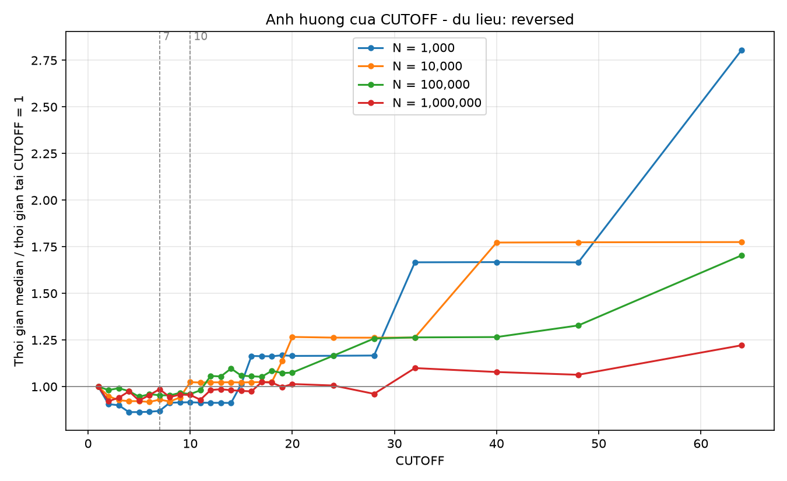
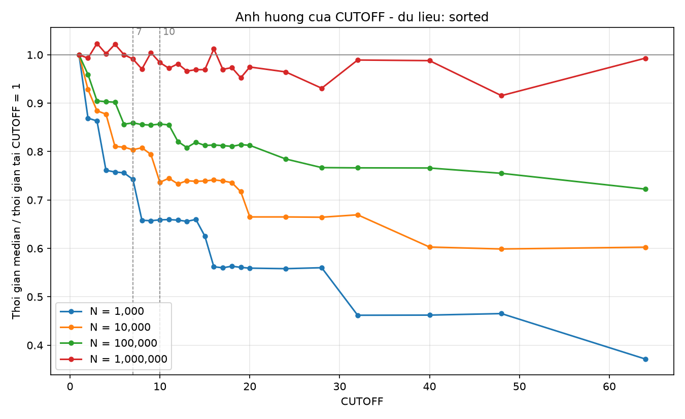
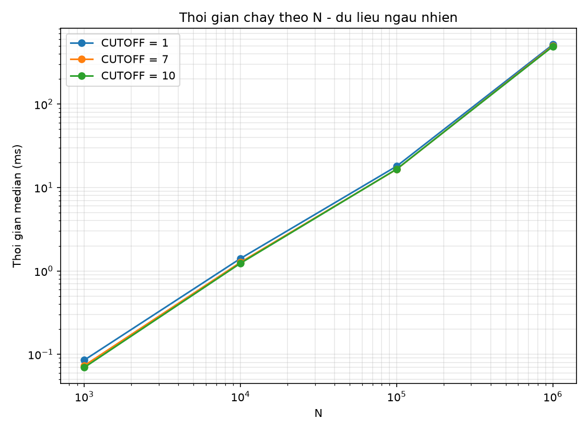

# Báo cáo thí nghiệm: Tìm giá trị CUTOFF tối ưu cho Mergesort

**Sinh viên:** Lê Duy Mạnh - MSV: 25020254
**Môn học:** Cấu trúc dữ liệu và giải thuật
**Ngày:** 17/11/2026

---

## 1. Mục tiêu

Mergesort có cải tiến dùng insertion sort cho mảng con nhỏ thay vì sử dụng đệ quy; giáo trình nêu CUTOFF = 7 (cũ) và 10 (mới); câu hỏi của thí nghiệm là giá trị nào phù hợp với máy của em, và vì sao phải đo thay vì chỉ dựa vào lý thuyết (chi phí thực tế phụ thuộc phần cứng, ngôn ngữ, JVM).

## 2. Cơ sở lý thuyết

- Mergesort dùng khoảng N log N phép so sánh, nhưng mỗi lần gọi đệ quy có chi phí cố định: gọi hàm, copy sang một mảng phụ `aux` sau đó merge 2 mảng con lại với nhau. 
- Insertion sort dùng khoảng n²/4 phép so sánh trên dữ liệu ngẫu nhiên, khoảng n trên dữ liệu đã sắp xếp, khoảng n²/2 trên dữ liệu đảo ngược; nhưng không có chi phí đệ quy và không cần mảng phụ.
- Vì vậy CUTOFF quá nhỏ thì lãng phí vào đệ quy, quá lớn thì phần bậc hai của insertion sort sẽ chiếm phần lớn thời gian. 
=> Dự đoán: thời gian theo CUTOFF có dạng chữ U, và vị trí đáy phụ thuộc kiểu dữ liệu.

## 3. Cài đặt
Mô tả code đã được cài đặt để thực hiện thí nghiệm **MergeSortCutOff**: 
- Sử dụng 1 hàm `merge` để merge 2 mảng con đã sắp xếp lại với nhau. 
- Một hàm `insertionSort` để sử dụng khi CUTOFF đạt đúng điều kiện, điều kiện này được kiểm tra trong hàm sort công khai. 
- Khi mảng đủ nhỏ để sử dụng InsertionSort trong đệ quy với điều kiện: `cuoi <= dau + cutoff - 1`, ta sẽ sử dụng InsertionSort để sắp xếp mảng con đó. 
- Nếu không đủ nhỏ thì tiếp tục đệ quy.

## 4. Phương pháp thí nghiệm

### 4.1. Cấu hình máy

| Thành phần | Giá trị |
|---|---|
| Máy / chip | Macbook Pro M1 Pro|
| Số nhân CPU | 10 |
| RAM | 32 GB |
| Hệ điều hành | macOS 26.7.3 (aarch64) |
| Java | Java HotSpot 25.0.2 |
| Heap JVM | 2048 MB (`-Xms2g -Xmx2g`) |
| Nguồn điện | cắm sạc |

### 4.2. Bộ dữ liệu

| Kiểu | Cách tạo | Mục đích |
|---|---|---|
| `random` | Số nguyên ngẫu nhiên | Trường hợp điển hình |
| `sorted` | Đã sắp xếp tăng dần | Trường hợp tốt nhất của insertion sort |
| `reversed` | Đã Sắp xếp giảm dần | Trường hợp xấu nhất của insertion sort |
| `nearly_sorted` | Đã sắp xếp, đổi chỗ ngẫu nhiên 1% số phần tử | Dữ liệu gần có thứ tự |
| `few_unique` | Có 10 giá trị khác nhau từ 0 đến 9 | Nhiều khóa trùng |

Mỗi kiểu có 4 kích thước N = 1.000; 10.000; 100.000; 1.000.000, tổng cộng 20 file trong `data/`. Dữ liệu sinh bằng `java.util.Random` với seed cố định `20261116`, nên có thể tái tạo chính xác.

### 4.3. Quy trình đo

a. Giá trị CUTOFF được chia thành 2 vùng: 
   * Vùng dày chạy từ `1-20 chứa 2 giá trị 7 và 10` có thể show ra đáy chữ U và cần độ phân giải cao để thấy chính xác chỗ nhảy bậc. 
   * Vùng thưa `24, 28, 32, 40, 48, 64` chỉ cần xác nhận đường cong đi lên lại. Đoạn con bị chia đôi nên càng về sau các bậc càng cách xa nhau (Dừng CUTOFF ở 64 vì CUTOFF 64 đã chậm hơn cả Mergesort thuần)
b. Năm vòng warm-up rồi 25 lần đo cho mỗi tổ hợp: 
   * Java không chạy code ở tốc độ tối đau ngay từ đầu mà qua 2 giai đoạn: 
      1. Lúc mới chạy thì JVM (Máy ảo của Java) đọc bytecode trong file `.class` và thông dịch từng lệnh một (tốc độ chậm).
      2. Sau khi hàm đc gọi nhiều lần: JVM nhận ra hàm đó dùng thường xuyên (quá tải) sẽ biên dịch nó thành mã máy CPU và tối ưu thêm. Từ đó hàm chạy nhanh hơn nhiều lần. Cơ chế này gọi là JIT (Just-In-Time compliatio, biên dịch đúng lúc cần).
   * Vì sao đo 25 lần: 
      - Kể khi đã warm-up, cùng một mảng và cùng một CUTOFF, mỗi lần đo vẫn ra số hơi khác: hệ điều hành chen việc khác vào, Java dừng lại dọn bộ nhớ, CPU đổi tốc độ theo nhiệt độ (Một lần đo có thể trúng lúc máy giật)
      - Đo 25 lần để lấy trung vị (xếp 25 số theo thứ tự, trung vị là số thứ 13) => các lần đo bật thường bị loại ra 1 cách tự nhiên. Cột `std_ms` trong `summary.csv` cho biết các lần dao động bao nhiêu. 
c. Được đo bằng `System.nanoTime()`; copy mảng trước khi bấm giờ: 
   * 
d. Mảng nhỏ: sắp xếp nhiều bản sao trong một lần đo (ít nhất 200.000 phần tử) rồi chia trung bình.
e. Xáo thứ tự CUTOFF ở mỗi vòng; gọi `System.gc()` trước mỗi vòng.
f. Kiểm tra tính đúng bằng cách so với `Arrays.sort`.
g. Dùng trung vị làm số liệu chính; chỉ số so sánh là `ratio = median(CUTOFF) / median(CUTOFF = 1)`.

## 5. Kết quả

### 5.1. So sánh CUTOFF = 7 và CUTOFF = 10

Thời gian trung vị (ms) và tỉ lệ so với mergesort thuần (trong ngoặc). Cột "Tốt nhất" là CUTOFF có trung vị nhỏ nhất trong 26 giá trị.

**Dữ liệu ngẫu nhiên**

| N | CUTOFF = 1 | CUTOFF = 7 | CUTOFF = 10 | Tốt nhất | Độ lệch chuẩn tại 10 |
|---|---|---|---|---|---|
| 1.000 | 0,0852 | 0,0732 (0,859) | 0,0696 (0,816) | 19 (0,795) | 3,1% |
| 10.000 | 1,408 | 1,268 (0,900) | 1,235 (0,877) | 19 (0,874) | 0,6% |
| 100.000 | 18,02 | 16,55 (0,918) | 16,61 (0,922) | 14 (0,907) | 1,2% |
| 1.000.000 | 517,3 | 500,5 (0,968) | 491,5 (0,950) | 17 (0,928) | 7,9% |

**Các kiểu dữ liệu khác (tỉ lệ so với CUTOFF = 1)**

| Kiểu | N | CUTOFF = 7 | CUTOFF = 10 | Tốt nhất |
|---|---|---|---|---|
| `few_unique` | 1.000 | 0,786 | 0,765 | 11 (0,754) |
| | 10.000 | 0,861 | 0,832 | 17 (0,827) |
| | 100.000 | 0,883 | 0,884 | 17 (0,864) |
| | 1.000.000 | 0,958 | 1,006 | 8 (0,901) |
| `reversed` | 1.000 | 0,870 | 0,916 | 4 (0,863) |
| | 10.000 | 0,930 | 1,024 | 6 (0,918) |
| | 100.000 | 0,954 | 0,960 | 5 (0,946) |
| | 1.000.000 | 0,986 | 0,955 | 2 (0,922) |
| `sorted` | 1.000 | 0,743 | 0,659 | 64 (0,371) |
| | 10.000 | 0,804 | 0,737 | 48 (0,599) |
| | 100.000 | 0,859 | 0,857 | 64 (0,723) |
| | 1.000.000 | 0,991 | 0,984 | 48 (0,916) |
| `nearly_sorted` | 1.000 | 0,756 | 0,674 | 64 (0,441) |
| | 10.000 | 0,796 | 0,726 | 40 (0,593) |
| | 100.000 | 0,815 | 0,816 | 64 (0,657) |
| | 1.000.000 | 0,942 | 0,950 | 64 (0,845) |

Số liệu đầy đủ của 520 tổ hợp: `results/summary.csv`.

### 5.2. Ảnh hưởng của CUTOFF theo từng kiểu dữ liệu

### 5.3. Thời gian chạy theo N

Dữ liệu ngẫu nhiên, thời gian trung vị (ms):

| CUTOFF | N = 1.000 | N = 10.000 | N = 100.000 | N = 1.000.000 |
|---|---|---|---|---|
| 1 | 0,085 | 1,408 | 18,02 | 517,3 |
| 7 | 0,073 | 1,268 | 16,55 | 500,5 |
| 10 | 0,070 | 1,235 | 16,61 | 491,5 |

Tỉ số thời gian khi N tăng 10 lần (CUTOFF = 10), so với tỉ số lý thuyết của N log N:

| Bước | Đo được | Lý thuyết N log N |
|---|---|---|
| 1.000 → 10.000 | 17,8 | 13,3 |
| 10.000 → 100.000 | 13,5 | 12,5 |
| 100.000 → 1.000.000 | 29,6 | 12,0 |

## 6. Phân tích

## 7. Hạn chế

## 8. Kết luận

## Phụ lục

- Mã nguồn: `MergeSortCutOff.java`, `Data.java`, `Benchmark.java`, `plot.py`
- Dữ liệu: `data/`; kết quả thô: `results/raw.csv`; tổng hợp: `results/summary.csv`
- Hướng dẫn chạy lại: `README.md`
- Sử dụng AI: (Các script đo, sinh dữ liệu và vẽ đồ thị được viết với sự hỗ trợ của AI; cài đặt mergesort do em tự viết từ slide bài giảng và bản Report được viết dưới sự hiểu biết về thí nghiệm của em). 